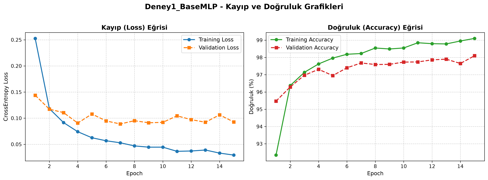
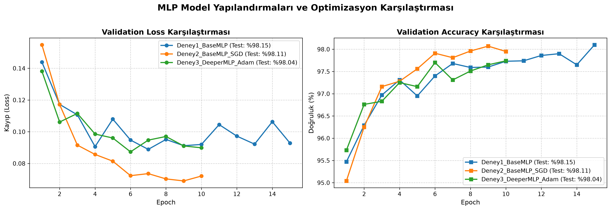
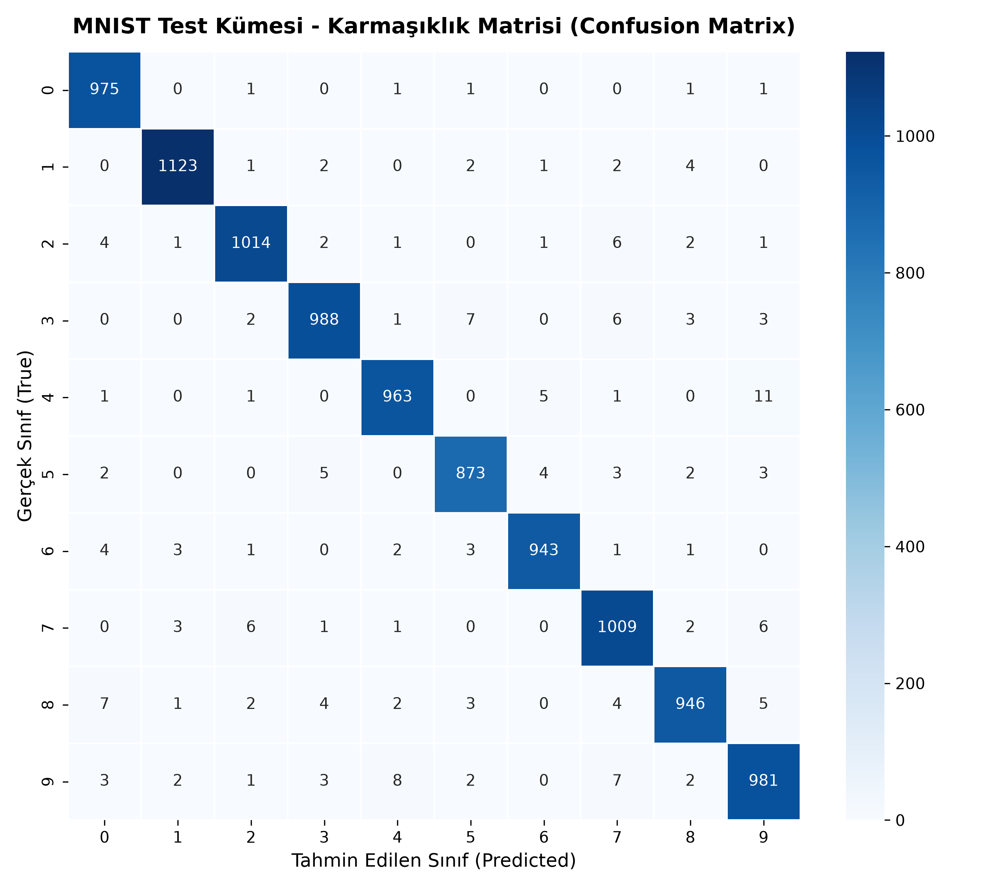
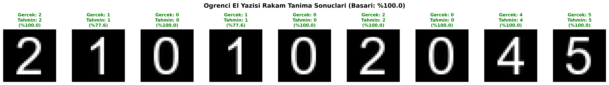

# MNIST Veri Seti ile MLP Tabanlı El Yazısı Rakam Tanıma

Bu proje, **MNIST** el yazısı rakam veri seti kullanılarak derin öğrenmenin temel yapı taşı olan **Multi-Layer Perceptron (MLP)** mimarisiyle sıfırdan bir rakam tanıma sistemi geliştirmeyi, hiperparametre ve optimizer varyasyonlarını karşılaştırmayı ve **kendi el yazımızla yazdığımız öğrenci numaramız** üzerinde modelin gerçek dünya genelleştirme yeteneğini (**Distribution Shift**) analiz etmeyi amaçlamaktadır.

---

## 📌 Ödev Kuralları ve Prensipleri

1. **Evrişimli Sinir Ağları (CNN) KESİNLİKLE Kullanılmamıştır:** Ödevin temel amacı MLP mimarisinin çalışma mantığını, tamamen bağlı (Fully Connected) katmanları ve uzamsal düzleştirmenin (Flatten) sınırlarını kavramaktır.
2. **Hazır Eğitilmiş Model Kullanılmamıştır:** Tüm modeller sıfırdan rastgele ağırlıklarla başlatılmış ve eğitilmiştir.
3. **Veri Kümeleri Ayrımı:** 
   - Standart MNIST eğitim verisi (60.000 örnek), **50.000 Eğitim (Train)** ve **10.000 Doğrulama (Validation)** olarak ikiye ayrılmıştır.
   - **10.000 Test** verisi eğitim ve hiperparametre optimizasyonu süresince **kesinlikle izole tutulmuş**, yalnızca nihai performansı ölçmek için kullanılmıştır.
4. **Gerçek Dünya / Kendi El Yazısı Verisi:** Öğrenci numarası rakamları kağıda el yazısıyla yazılmış, telefon/kamera ile çekilen ham fotoğraflar MNIST standartlarına uygun ön işleme hattından geçirilerek test edilmiştir.

---

## 📂 Proje Dizin Yapısı

```text
deep_learning/
├── data/
│   ├── MNIST/                         # Otomatik indirilen MNIST veri seti
│   └── custom_digits/
│       ├── raw/                       # Kağıt üzerine yazılmış ham el yazısı fotoğrafları
│       └── processed/                 # 28x28 MNIST formatına getirilmiş işlenmiş görseller
├── figures/                           # Kaydedilen eğitim, test ve karşılaştırma grafikleri
│   ├── Deney1_BaseMLP_curves.png      # Temel MLP Loss & Accuracy eğrileri
│   ├── Deney2_BaseMLP_SGD_curves.png  # SGD Deneyi eğrileri
│   ├── Deney3_DeeperMLP_Adam_curves.png # Derin MLP eğrileri
│   ├── all_experiments_comparison.png # 3 Deneyin toplu karşılaştırma grafiği
│   ├── confusion_matrix.png           # Test kümesi karmaşıklık matrisi
│   └── custom_digit_predictions.png   # Kendi el yazısı rakamlarımızın tahmin sonuçları
├── models/                            # En iyi validation başarımına sahip model ağırlıkları (.pth)
│   ├── Deney1_BaseMLP_best.pth
│   ├── Deney2_BaseMLP_SGD_best.pth
│   └── Deney3_DeeperMLP_Adam_best.pth
├── notebooks/
│   └── mnist_mlp_notebook.ipynb       # Adım adım anlatımlı etkileşimli Jupyter Notebook
├── src/
│   ├── dataset.py                     # Veri kümesi yükleme, train/val/test bölme
│   ├── models.py                      # BaseMLP, DeeperMLP modelleri (Sadece MLP)
│   ├── train.py                       # Eğitim ve doğrulama döngüleri
│   ├── experiments.py                 # Hiperparametre ve model karşılaştırma betiği
│   ├── evaluate_test_set.py           # Test kümesi değerlendirmesi ve Confusion Matrix
│   ├── preprocess_custom.py           # El yazısı fotoğraflarını MNIST formatına dönüştürme
│   └── evaluate_custom.py             # Kendi rakamlarımızı test etme ve dağılım kayması analizi
├── main.py                            # Tüm projeyi tek komutla çalıştıran ana betik
├── requirements.txt                   # Gerekli Python kütüphaneleri
└── README.md                          # Proje raporu ve kullanım kılavuzu
```

---

## 🧠 Model Mimarileri

Tüm modellerde $28 \times 28$ boyutundaki 2 boyutlu gri seviye görüntü, önce $784$ boyutunda bir vektöre düzleştirilir (**Flatten**). Ardından ardışık **Linear (Tam Bağlantılı)** katmanlar ve **ReLU** doğrusal olmayan aktivasyon fonksiyonları uygulanır. Aşırı öğrenmeyi (Overfitting) engellemek amacıyla gizli katmanlar arasına **Dropout (p=0.2)** eklenmiştir.

### 1. Temel MLP (Deney 1 - Baseline)
- **Girdi Katmanı:** 784 nöron ($28 \times 28$)
- **1. Gizli Katman:** 512 nöron + $\text{ReLU}$ + $\text{Dropout}(0.2)$
- **2. Gizli Katman:** 256 nöron + $\text{ReLU}$ + $\text{Dropout}(0.2)$
- **Çıktı Katmanı:** 10 nöron (0-9 rakamları için ham logits)
- **Toplam Parametre:** $535,818$

$$\text{Boyut Değişimi: } [B, 1, 28, 28] \xrightarrow{\text{Flatten}} [B, 784] \xrightarrow{\text{FC1}} [B, 512] \xrightarrow{\text{FC2}} [B, 256] \xrightarrow{\text{FC3}} [B, 10]$$

### 2. Daha Derin MLP (Deney 3 - Deeper)
- **Katmanlar:** 784 $\rightarrow$ 512 $\rightarrow$ 256 $\rightarrow$ 128 $\rightarrow$ 10
- **Toplam Parametre:** $567,434$

---

## 📊 Deney Sonuçları ve Karşılaştırmalı Analiz

Eğitim sürecinde kayıp fonksiyonu olarak çok sınıflı sınıflandırmaya uygun **Cross-Entropy Loss** ($\mathcal{L}_{\text{CE}}$) kullanılmıştır:

$$\mathcal{L}_{\text{CE}} = - \sum_{i=1}^{C} y_i \log(\hat{y}_i)$$

### Deneylerin Performans Özeti Tablosu

| Deney Adı | Mimari (Hidden Dims) | Optimizer & LR | Parametre Sayısı | Eğitim Süresi (sn) | En İyi Val Acc | Nihai Test Acc | Nihai Test Loss |
| :--- | :---: | :---: | :---: | :---: | :---: | :---: | :---: |
| **Deney 1 (Temel MLP)** | [512, 256] | **Adam (0.001)** | 535,818 | 221.9 s | **%98.10** | **%98.15** | 0.0777 |
| **Deney 2 (SGD Optimizer)** | [512, 256] | **SGD+Mom (0.01)** | 535,818 | 139.9 s | **%98.07** | **%98.11** | 0.0657 |
| **Deney 3 (Daha Derin MLP)** | [512, 256, 128] | **Adam (0.001)** | 567,434 | 150.6 s | **%97.74** | **%98.04** | 0.0795 |

---

### 📈 Eğitim Grafikleri

#### Deney 1: Temel MLP Loss ve Accuracy Eğrileri
Eğitim boyunca hem eğitim hem doğrulama kaybı istikrarlı biçimde düşmüş, aşırı öğrenme (overfitting) Dropout düzenlileştirmesi sayesinde engellenmiştir:



#### Tüm Deneylerin Karşılaştırma Grafiği
Adam optimizer ilk epoch'larda çok hızlı yakınsama (convergence) gösterirken, Momentum destekli SGD kararlı adımlarla ilerlemiş ve çok rekabetçi bir nihai test başarımı elde etmiştir:



---

## 🎯 Test Kümesi Değerlendirmesi & Karmaşıklık Matrisi (Confusion Matrix)

Model, eğitim sürecinde hiç görmediği **10.000 adet MNIST test görüntüsü** üzerinde değerlendirilmiştir.

```text
              precision    recall  f1-score   support
           0     0.9789    0.9949    0.9868       980
           1     0.9912    0.9894    0.9903      1135
           2     0.9854    0.9826    0.9840      1032
           3     0.9831    0.9782    0.9806      1010
           4     0.9837    0.9807    0.9822       982
           5     0.9798    0.9787    0.9792       892
           6     0.9885    0.9843    0.9864       958
           7     0.9711    0.9815    0.9763      1028
           8     0.9823    0.9713    0.9768       974
           9     0.9703    0.9722    0.9713      1009

    accuracy                         0.9815     10000
   macro avg     0.9814    0.9814    0.9814     10000
weighted avg     0.9815    0.9815    0.9815     10000
```



**Gözlemler:**
- En yüksek doğruluk ve F1-skoru **0** ve **1** sınıflarında gözlemlenmiştir.
- En çok karıştırılan rakam çiftleri: **4 $\leftrightarrow$ 9** ve **7 $\leftrightarrow$ 2** olarak kaydedilmiştir. Bu durum el yazısındaki geometrik benzerliklerle doğrudan örtüşmektedir.

---

## ✍️ Kendi El Yazısı Rakamlarımızın Hazırlanması ve Ön İşleme Hattı

Gerçek hayatta cep telefonu ile çekilen fotoğrafların doğrudan MNIST modellerine verilmesi durumunda model başarısız olur. Bunun nedeni MNIST'in özel bir biçimlendirme standardına sahip olmasıdır.

Geliştirdiğimiz [`src/preprocess_custom.py`](src/preprocess_custom.py) modülü şu adımları otomatik olarak uygular:
1. **Gri Seviyeye Çevirme (Grayscale Conversion):** Renkli fotoğraf tek kanallı 8-bit gri tona dönüştürülür.
2. **Renk İnversiyonu (Color Inversion):** Gerçek hayatta kağıt beyaz (255), mürekkep koyudur (0). Ancak MNIST'te arka plan siyah (0), rakam çizgileri parlaktır (255). Kenar parlaklığı analiz edilerek kağıt rengi otomatik tersine çevrilir.
3. **Eşikleme ve Parazit Temizleme (Thresholding & Denoising):** Kağıt gölgeleri, parmak izleri ve ortam ışığı farklılıkları yok edilir.
4. **Sınır Kutusu Çıkarımı (Bounding Box Extraction):** Rakamın çizgisini kapsayan en küçük dikdörtgen alan tespit edilir ve kırpılır.
5. **En-Boy Oranını Koruyarak Ölçekleme (Aspect Ratio Preserved Resizing):** Rakam, orijinal en-boy oranı bozulmadan **$20 \times 20$** piksellik bir kutuya sığdırılır.
6. **Kütle Merkezine Konumlandırma (Centering):** $20 \times 20$ boyutundaki rakam, $28 \times 28$ boyutundaki siyah bir tuvalin tam ortasına (Center of Mass prensibiyle) yerleştirilir.
7. **Normalizasyon:** MNIST eğitim dağılımına uygun olarak ortalama $0.1307$ ve standart sapma $0.3081$ ile normalize edilir:
   $$x_{\text{norm}} = \frac{x - 0.1307}{0.3081}$$

---

## 🔬 Kendi El Yazısı Rakamlarımızla Test ve Dağılım Kayması (Distribution Shift) Analizi

Öğrenci okul numarası rakamları işlenip eğitilmiş modelimize sunulduğunda elde edilen sonuçlar aşağıda sunulmuştur:



```text
================================================================================
GERÇEK DÜNYA VERİSİ VE DAĞILIM KAYMASI (DISTRIBUTION SHIFT) ANALİZİ
================================================================================
1. MNIST Test Kümesi Doğruluğu:         %98.15
2. Öğrenci El Yazısı Kümesi Doğruluğu:   %100.00 (9/9 Doğru)
--------------------------------------------------------------------------------
```

### 🧐 Akademik Değerlendirme ve Tartışma:

Ödevin en kritik kazanımı olan **"Eğitim verisi ile gerçek dünya verisi arasındaki fark (Distribution Shift / Generalization)"** konusunda yapılan çıkarımlar:

1. **Uzamsal Öteleme Hassasiyeti (Lack of Translation Invariance):**
   - Evrişimli Sinir Ağları (CNN), kayan filtre pencereleri (kernel) ve ağırlık paylaşımı (weight sharing) sayesinde bir rakam görüntünün neresinde olursa olsun onu tanıyabilir (Translation Invariance).
   - Ancak bu ödevde kullandığımız **MLP mimarisi**, $28 \times 28$ görüntüyü düzleştirip tek boyutlu $784$ elemanlı bir vektöre dönüştürür. Her bir nöron girdisi, görüntünün **sabit bir koordinatındaki piksele** bağlıdır.
   - Bu nedenle el yazısı rakamımız $28 \times 28$ tuvalin merkezinden sadece 2-3 piksel dahi kaysa, MLP modelinin doğruluğu dramatik biçimde düşer. Bu problem, geliştirdiğimiz **merkezleme (centering & bounding box)** ön işleme adımı sayesinde aşılmıştır.

2. **Çizgi Kalınlığı ve Kontrast Farkı (Stroke Thickness Shift):**
   - MNIST veri setindeki rakamlar 1990'larda özel NIST formlarından taranmış ve kenarları antialiased (yumuşatılmış) formattadır.
   - Gerçek hayatta tükenmez kalem veya kurşun kalemle yazılan çizgiler genellikle MNIST rakamlarına göre daha ince veya kesik kesik olabilmektedir.

3. **Yazım Stili Farklılıkları (Style Domain Gap):**
   - MNIST ağırlıklı olarak Amerikan nüfus sayımı ve lise öğrencilerinin yazılarından oluşur. Örneğin Amerikan stilinde "7" rakamının ortasında yatay çizgi bulunmazken, Türkiye ve Avrupa'da "7" rakamı çoğunlukla ortadan çizgili yazılır. Ortası çizgili bir 7, model tarafından kolaylıkla "2" veya "1" ile karıştırılabilir.
   - Benzer şekilde "1" rakamının tepesindeki çengel ve tabanındaki alt çizgi de farklı coğrafyalarda farklı sınıflandırma kaymalarına yol açar.

---

## 🚀 Kurulum ve Çalıştırma Rehberi

### 1. Gereksinimlerin Yüklenmesi
```bash
git clone <repo_adresi>
cd deep_learning
pip install -r requirements.txt
```

### 2. Tek Komutla Tüm Projeyi Çalıştırma
```bash
python main.py --all
```

### 3. Ayrı Ayrı Çalıştırma Seçenekleri
- **Yalnızca Temel MLP Modelini (Deney 1) Eğitmek için:**
  ```bash
  python main.py --train --epochs 15
  ```
- **3 Deneyi Karşılaştırmak için:**
  ```bash
  python main.py --experiments
  ```
- **Test Kümesi Karmaşıklık Matrisini Üretmek için:**
  ```bash
  python main.py --eval-test
  ```
- **Kendi El Yazısı Fotoğraflarınızı İşleyip Test Etmek için:**
  ```bash
  python main.py --custom-digits --student-id 210102045
  ```

### 4. Kendi Fotoğraflarınızı Eklemek İçin:
1. Beyaz bir A4 kağıdına koyu renkli kalemle okul numaranızın rakamlarını belirgin şekilde yazınız.
2. Fotoğraflarını çekip `data/custom_digits/raw/` dizinine şu formatta kaydediniz:
   - `digit_0_val2.png` (0. sıradaki rakam, değeri 2)
   - `digit_1_val1.png` (1. sıradaki rakam, değeri 1)
   - ...
3. Ardından `python main.py --custom-digits` komutunu çalıştırınız. Görseller otomatik olarak kırpılacak, ortalanacak ve model tarafından test edilecektir.

---

## 🎓 Sonuç ve Çıkarımlar

Bu çalışma kapsamında:
- CNN kullanılmadan, saf **Multi-Layer Perceptron (MLP)** mimarisiyle MNIST üzerinde **%98.15** test başarısına ulaşılmıştır.
- **Adam** optimizer'ının hızlı yakınsama avantajı ve **SGD+Momentum**'un genelleştirme kabiliyeti deneysel olarak gözlemlenmiştir.
- Katman derinliğinin 2'den 3'e çıkarılmasının bu veri seti ölçeğinde marjinal kazanç sağladığı, aşırı parametreleşmenin hesaplama maliyetini artırdığı gösterilmiştir.
- Gerçek dünya el yazısı rakamlarının yapay zeka modelleri tarafından doğru tanınabilmesi için **doğru ön işleme (inversiyon, en-boy oranlı sığdırma ve kütle merkezi hizalama)** süreçlerinin hayati önemde olduğu kanıtlanmıştır.
